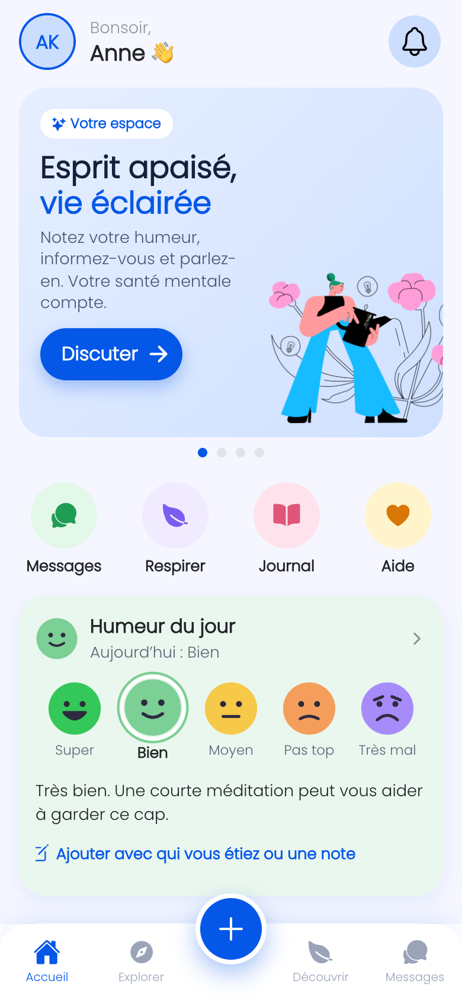
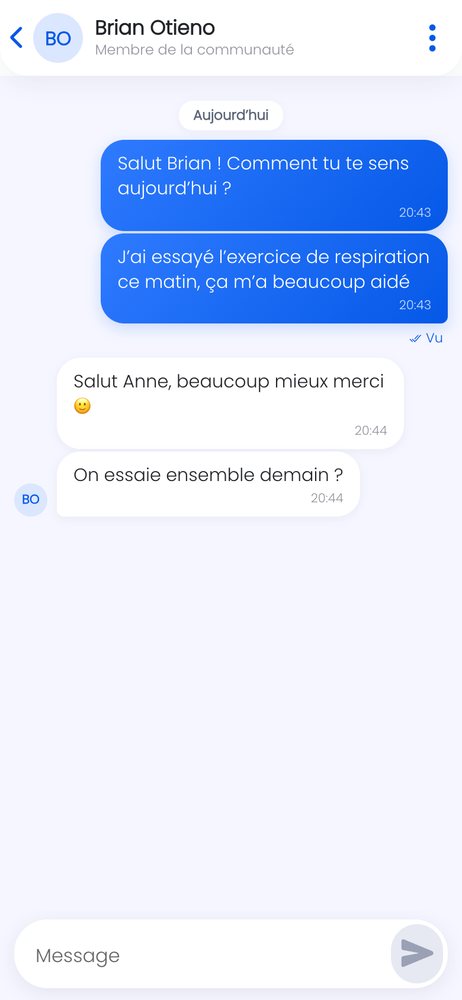
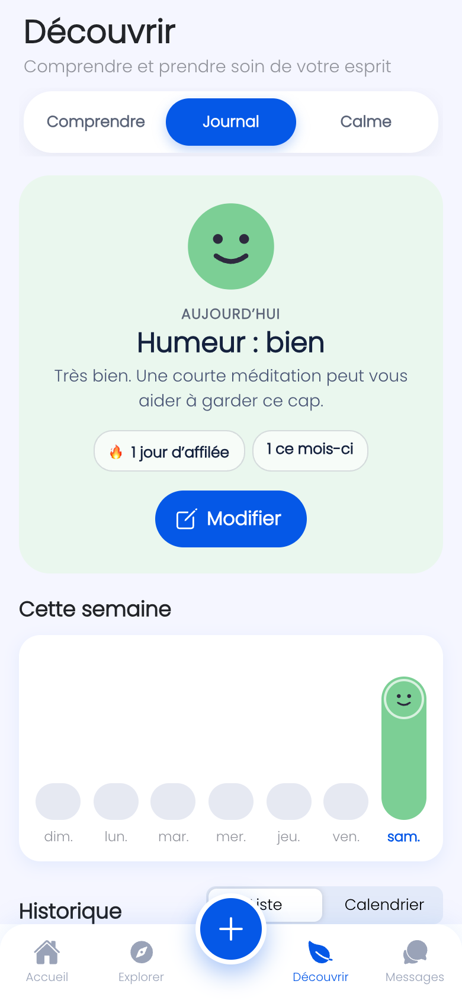
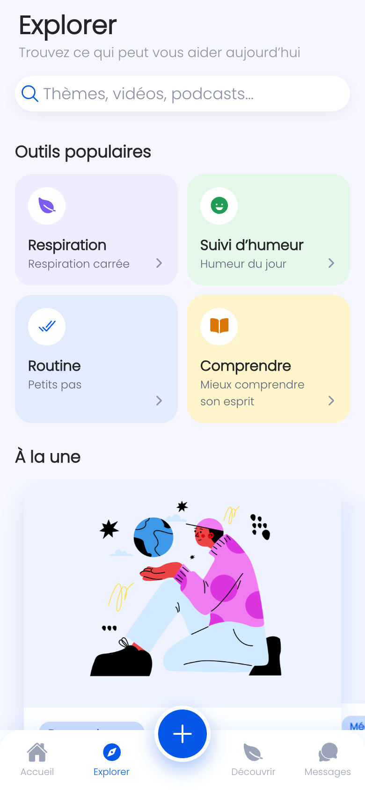
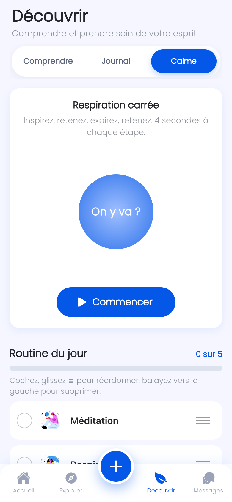
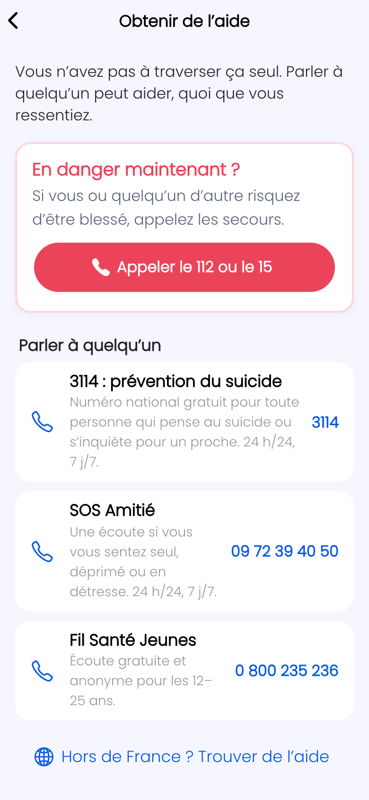

# Soul App: mental wellbeing and chat (Ionic + Angular + Firebase)

A mobile-first wellbeing app. People can check in on their mood, explore guided sessions, learn about common conditions, and chat one-to-one with others in real time.

The app is in French, for users in France: all text, dates and times, the helplines, and Firebase's password reset emails.

## Features

- **No sign-up wall.** The app opens straight to Home as a guest. An account is only needed for chat. If a guest signs up later, they keep their mood diary and routine.
- **Home**
  - "Better mind, brighter you" welcome card and shortcuts to Chat, Breathe, Diary and Get help.
  - Daily mood with a coloured face for each mood, saved to Firestore.
  - Featured sessions and personalised insights.
- **Daily check-in (the + in the tab bar)**: mood, who you were with and an optional note, from any tab.
- **Explore**
  - Popular tools (breathing, mood tracker, routine, learn).
  - Sessions by topic and by format (video, podcast or audio).
  - A detail sheet with media playback.
- **Discover**
  - Learn: condition guides.
  - Mood diary: today's summary with streak, a weekly mood chart, and history as a list or a calendar.
  - Calm: box breathing and a daily routine checklist.
- **Chat**
  - Real-time one-to-one conversations with unread markers and search.
  - Messages are grouped by day.
  - Only the two people in a conversation can read it, enforced by Firestore rules.
  - Block or report someone from the ⋮ menu in a conversation. Reports go to the `reports` collection for review in the Firebase console.
- **Get help now:** emergency number and French helplines (`/help`), linked from Home, Discover and Chat. Edit the numbers in `src/app/pages/help/helplines.ts`.
- **Privacy:** other members see only your name and photo. Your email is kept in a private document only you can read.
- **Forgot password:** sends a reset link from the login screen.

## Technologies

- Ionic 7 and Angular 17
- Firebase Authentication (email/password and anonymous guest sessions)
- Cloud Firestore, via AngularFire 7 compat
- TypeScript and SCSS

## Project presentation

https://docs.google.com/presentation/d/1eqkLxWmaBLTHLHckOPQ-4BlqrnywFh1fvsMaZ-XiPZU

## Screenshots

| Home | Chat | Mood diary |
| --- | --- | --- |
|  |  |  |

| Explore | Calm | Help |
| --- | --- | --- |
|  |  |  |

## Getting started

```bash
npm install
npm start          # http://localhost:4200, uses the real Firebase project
```

### Firebase setup (once, in the Firebase console)

1. Go to **Authentication → Sign-in method** and enable **Email/Password** and **Anonymous** (Anonymous is for guests).
2. Go to **Firestore → Rules** and publish the rules in `firestore.rules`, or run `firebase deploy --only firestore:rules`.

### Testing locally with the Firebase emulators

You can try chat with several test accounts without touching real data:

```bash
npm run emulators        # terminal 1: local Auth + Firestore, using the real security rules
npm run start:emulator   # terminal 2: the app, connected to the emulators
```

Sign up two accounts in two browser windows (or one normal and one private window), then start a chat. Emulator data is wiped when the emulators stop. The emulators need Java and the Firebase CLI installed.

### Tests

```bash
npx ng test --watch=false --browsers=ChromeHeadless
```

## Architecture

- `src/app/tab1`, `tab2`, `tab4`: the Home, Explore and Discover tabs.
- `src/app/pages/home`: the chat list. `pages/home/chat` is a chat room (`/home/chats/:id`).
- `src/app/services`:
  - `auth`: accounts and guest sessions.
  - `chat`: conversations and messages.
  - `mood`: check-ins and the mood diary.
  - `content`: the session library.
- `src/app/guards`:
  - `SessionGuard` starts a guest session for the tabs.
  - `AuthGuard` asks guests to sign up before they can chat.
- `src/app/pages/help`: the Get help now page and its list of helplines.
- `src/app/components`: the avatar (initials when there's no photo), the chat bubble, the mood face and the daily check-in sheet.
- `src/app/locale.ts`: the locale used for dates and times (`fr-FR`).
- `firestore.rules`: who can read and write what.

### Data model

| Path | Contents |
| --- | --- |
| `users/{uid}` | Public profile: name and photo only |
| `users/{uid}/private/account` | Email (only the owner can read it) |
| `users/{uid}/moods/{YYYY-MM-DD}` | Mood check-in and diary note. `mood` and `with` hold English keys (`Great`, `Family`); the French labels come from `MOODS` and `COMPANY` in `mood.service.ts` |
| `users/{uid}/routine/{YYYY-MM-DD}` | Daily routine checklist |
| `chats/{uidA_uidB}` | The two participants, last-message preview, read receipts, who has blocked |
| `chats/{id}/messages/{id}` | `text`, `senderId`, `timestamp` |
| `reports/{id}` | Reports about a conversation (reason + recent messages); write-only from the app |
| `content/{id}` | Optional session library; the app has a built-in list if this is empty |
